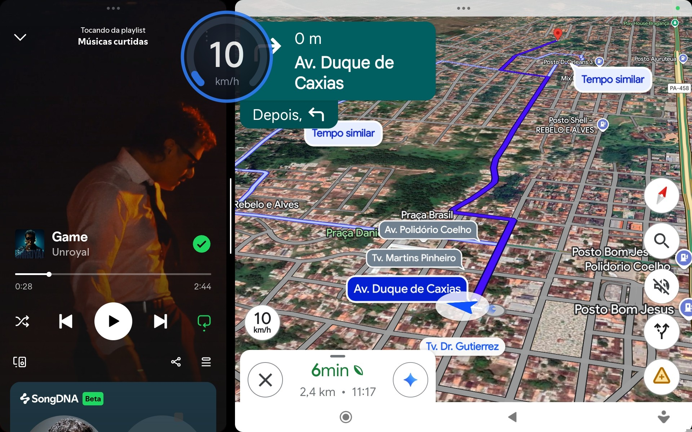
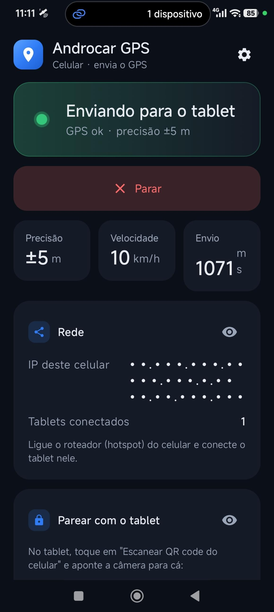
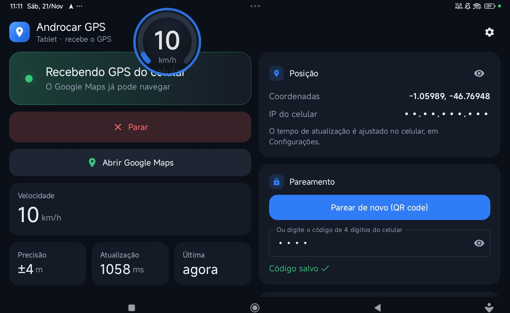

<div align="center">

# 📍 Androcar GPS

**Envia o GPS do celular para o tablet, para o Google Maps navegar no carro mesmo em tablet sem GPS.**

[](https://github.com/heitorcampos2/Androcar_Gps/releases/latest/download/Androcar_Gps.apk)


</div>

---

## Prints

<p align="center">
  <br>
  <sub>Tablet: Google Maps navegando com o GPS do celular, Spotify ao lado e o velocímetro flutuante</sub>
</p>

<table>
  <tr>
    <td align="center" width="28%"><br><sub>Celular enviando o GPS</sub></td>
    <td align="center"><br><sub>Tablet recebendo o GPS</sub></td>
  </tr>
</table>

## Como funciona

```
 Celular (GPS)  ──►  roteador do celular  ──►  Tablet  ──►  Google Maps
   modo Enviar        (hotspot / Wi-Fi)        modo Receber    (local fictício)
```

1. **Celular, modo Enviar:** lê o GPS em alta precisão, uma vez por segundo, e envia a posição.
2. **Conexão:** o tablet fica no roteador (hotspot) do celular, que também dá a internet do Maps. O tablet acha o celular sozinho, sem digitar IP.
3. **Tablet, modo Receber:** aplica a posição como **local fictício** do Android.
4. **Google Maps** usa como se fosse o GPS do próprio tablet: ponto azul, direção, velocidade e navegação.

## Instalação

Instale o **mesmo APK** nos dois aparelhos e, na primeira abertura, escolha o modo de cada um.

### No celular
1. Abra o app → **Celular · Enviar GPS** → **Iniciar**.
2. Anote o **código de pareamento** (4 dígitos).
3. Ligue o **roteador Wi-Fi (hotspot)**.

### No tablet (uma vez só)
1. Ative o **modo desenvolvedor**: Configurações → Sobre o tablet → toque 7 vezes em *Versão do SO*.
2. Em **Opções do desenvolvedor → Selecionar app de local fictício**, escolha **Androcar GPS**.
3. Conecte o tablet no hotspot do celular.
4. Abra o app → **Tablet · Receber GPS** → digite o código → **Iniciar**.
5. Abra o **Google Maps** e navegue. 🚗

### Aparelhos Xiaomi (HyperOS / MIUI)
Para o sistema não fechar o app no meio da viagem, em *Informações do app*, nos dois aparelhos:
- **Energia → Sem restrições**
- **Início automático → ligado**
- **Pausar atividade do app quando sem uso → desligado**

## Recursos

- ✅ Um APK só, dois modos (Enviar / Receber)
- ✅ Encontra o celular sozinho no hotspot
- ✅ Pareamento por código de 4 dígitos
- ✅ Reconecta sozinho se o Wi-Fi cair e avisa quando o sinal se perde
- ✅ Botão nas configurações rápidas (barra de notificações) para ligar e desligar
- ✅ Velocímetro flutuante por cima do Maps (digital, anel ou analógico; tamanho, cor e transparência ajustáveis)
- ✅ Tempo de atualização ajustável em milissegundos
- ✅ PIN, QR code e IPs escondidos com olhinho de privacidade
- ✅ Economia de bateria: o GPS do celular só liga com o tablet conectado
- ✅ Atualização pelo próprio app (Configurações → Verificar atualização)

## Perguntas rápidas

**Precisa de root?** Não. Só o modo desenvolvedor no tablet.

**Funciona com o Waze?** O foco é o Google Maps. O Waze pode funcionar, mas não é testado.

**Posso usar o Fake GPS junto?** Não ao mesmo tempo: o Android aceita um app de local fictício por vez.

## Para desenvolver

- Kotlin + Jetpack Compose, Android 8.0+
- Cada push no `main` compila pelo GitHub Actions e publica a release `v1.0.<n>` com o `Androcar_Gps.apk`
- O app instalado vê a release nova e se atualiza

---

<div align="center">

Desenvolvido por **Heitor Campos** · [GitHub heitorcampos2](https://github.com/heitorcampos2)

</div>
